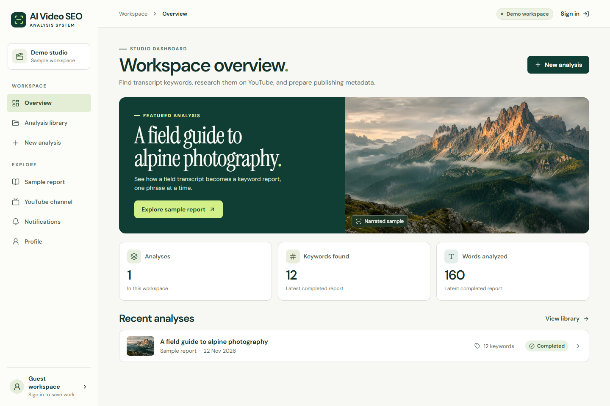
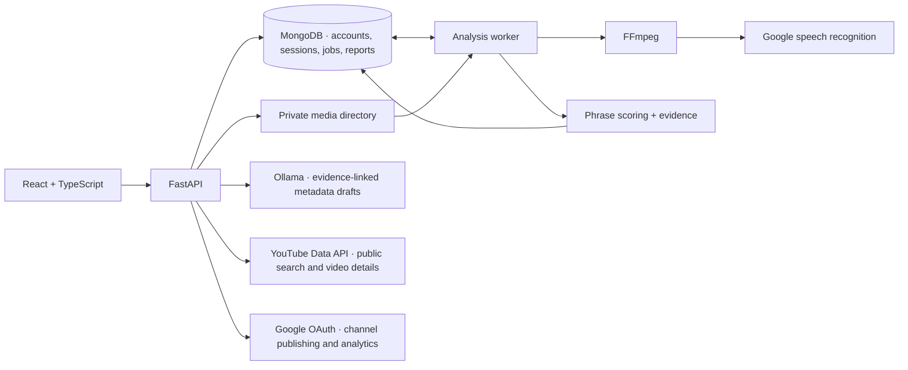

# AI Video SEO Analysis System

A creator workspace for understanding the language in a video, researching keywords on YouTube and preparing a channel upload. Start with the narrated alpine photography sample. Click a keyword to read its source passage, play the matching moment and look up that phrase on YouTube.

| From the report | What you can do |
| --- | --- |
| Keywords | Inspect phrase mentions, relative relevance and evidence. Export the keyword table as CSV. |
| Transcript | Correct recognition errors and recalculate the report. Timed passages keep their original audio intervals. |
| YouTube research | Choose a region, request up to ten search results, inspect public video statistics and save a personal competition assessment. |
| AI metadata | Generate editable titles, descriptions, tags and chapter suggestions with a local model. Review the rationale and source passage for each suggestion. |
| YouTube channel | Connect a channel through Google, view 28 days of analytics, edit video metadata or upload a selected source using a reviewed draft. |
| Personal workspace | Sign in to revisit private reports, manage a profile and read analysis and channel notifications. |



## Where to start reading the code

Follow one report from input to publication.

| Step | Entry point | What to look for |
| --- | --- | --- |
| Submit and process | [analysis_v2.py](backend/analysis_v2.py) | `create_analysis` accepts the input. `claim_job` and `process_claim` handle background processing and save the report. |
| Rank phrases | [analysis_text.py](backend/analysis_text.py) | `collect_phrases` counts mentions and distinct segments. `relevance_weight` contains the scoring formula. `rank_keywords` selects phrases and attaches evidence. |
| Inspect a result | [Report.tsx](frontend/src/v2/Report.tsx) | The completed report connects keyword rows, transcript passages, research and metadata editing. |
| Research a keyword | [research.py](backend/research.py) | `lookup` handles the cache and request budget. `fetch_youtube` retrieves public video data. Competition assessments are stored separately. |
| Edit and generate | [editor.py](backend/editor.py) | `correct` updates the transcript and scores. `infer` requests local model output and `parse_suggestions` verifies quoted evidence. |
| Prepare and publish | [PublishingDraft.tsx](frontend/src/v2/PublishingDraft.tsx) and [channel.py](backend/channel.py) | Review the title, description and chapter times. The channel API handles Google authorization and the confirmed upload. |

## Try it locally

From the folder containing this README, run the app and MongoDB with Docker Compose.

```sh
docker compose up --build
```

Open [the studio](http://127.0.0.1:8000/) or go directly to [the sample report](http://127.0.0.1:8000/analyses/sample). To try a private report, choose **New analysis**, create an account, and paste a transcript. Its processing status and final report survive a page refresh. Compose keeps the database and uploaded media in named volumes. Docker uses the database name `framewise` for compatibility with earlier installations. Native Windows setup defaults to `video_seo_db` on the local MongoDB server, so the two setups have separate workspaces by default.

If port 8000 is already occupied, set `FRAMEWISE_PORT` to another local port before starting Compose.

### Native Windows setup

Use Python 3.12, Node 24, npm, and a running MongoDB instance. From the project root in PowerShell:

```powershell
py -3.12 -m venv backend/.venv
backend/.venv/Scripts/python.exe -m pip install -r backend/requirements.txt
npm.cmd --prefix frontend ci
npm.cmd --prefix frontend run build
.\run.bat
```

The API uses the local MongoDB server and the `video_seo_db` database by default. For a different database or deployment origin, copy [the configuration example](backend/.env.example) to `backend/.env` and edit it. The public sample and its media are bundled with the frontend.

For frontend development, run the API on port 8000 and `npm run dev` inside `frontend`. Vite forwards API requests to the local backend. After changing the frontend, run `npm run build` to refresh the files served by the API.

## Turn on the integrations

The sample, pasted-transcript analysis and account features run with the basic setup. Configure the following integrations in `backend/.env` to use them. Only the API needs Google credentials. With Docker, use Compose 2.24 or newer and recreate the app after changing its environment.

### YouTube keyword research

Enable **YouTube Data API v3** in your Google Cloud project. Create a server API key restricted to that API, set `YOUTUBE_API_KEY`, then open a report and choose **YouTube research → Look up on YouTube**. The request sends the selected phrase and region. The page shows the collection time, video links and the view, like and comment counts supplied by YouTube. Repeated lookups can reuse a six-hour snapshot. `YOUTUBE_RESEARCH_DAILY_LIMIT` controls the installation’s daily new lookups and defaults to 60.

A relevance of 100 identifies the highest-scoring phrase in that transcript. Mentions count occurrences in the recognized or edited text. Two phrases can have the same count but different scores. YouTube search returns matching videos. Competition in this app is a private editorial assessment made by the creator. [YouTube search reference](https://developers.google.com/youtube/v3/docs/search/list) · [YouTube API developer policies](https://developers.google.com/youtube/terms/developer-policies)

### Local AI metadata

For native setup, install Ollama on the API machine, start it and run `ollama pull llama3.2:3b`. For Docker, the optional `ai` profile runs Ollama on the API container’s loopback network and persists model downloads.

```sh
docker compose --profile ai up -d --build
docker compose --profile ai exec ollama ollama pull llama3.2:3b
```

Open **AI metadata** in a completed private report to generate a draft. The model receives the report title, extracted phrases and up to 16 excerpts sampled across the transcript. Each excerpt is limited to 400 characters. A draft keeps its source revision. Correcting a transcript flags an older draft for review. Set `OLLAMA_MODEL` to use a different installed local model that supports structured output. Generation speed depends on the model and available memory.

### Connect a YouTube channel

1. Enable **YouTube Data API v3** and **YouTube Analytics API** in Google Cloud. Configure the OAuth consent screen and add your Google account as a test user if the app is in testing.
2. Create a **Web application** OAuth client. Register the exact redirect URI. The native default is `http://127.0.0.1:8000/api/channel/oauth/callback`. Use the public HTTPS origin and the same path when deploying.
3. Set `YOUTUBE_CLIENT_ID`, `YOUTUBE_CLIENT_SECRET`, `YOUTUBE_REDIRECT_URI` and `YOUTUBE_TOKEN_KEY` on the server. Generate a Fernet key once using the installed backend environment and keep it in your deployment’s secret store.

   ```sh
   python -c "from cryptography.fernet import Fernet; print(Fernet.generate_key().decode())"
   ```

4. Restart the app. Sign in, open **YouTube channel** and approve Google access. The requested scopes support channel reads, analytics and video management. The API encrypts stored grants. Use **Disconnect** to revoke the grant.
5. Choose **Prepare YouTube upload** on a saved draft. Pick a title and description, optionally append chapter timestamps from timed source passages, and review the resulting text, tags, audience, visibility and source before confirming the upload. The original analysis file is removed after successful transcription, so select the video again for publishing. Verify the visibility YouTube actually grants in YouTube Studio. Public distribution may require Google verification or a YouTube audit for the project. [Google OAuth setup](https://developers.google.com/youtube/v3/guides/auth/server-side-web-apps) · [YouTube upload reference](https://developers.google.com/youtube/v3/docs/videos/insert)

## How the analysis works

1. The API authenticates the user, validates the input, saves it under a unique job ID, and returns a queued report. A transcript may contain up to 60,000 characters. Uploaded audio or video may be up to 100 MiB and 15 minutes.
2. A background worker claims the job in MongoDB. For media, FFmpeg decodes a mono audio track and the speech recognizer sends audio to Google after the user consents. Pasted text is processed locally. The original media is removed after successful processing. Failed jobs retain their source for retry.
3. The extractor counts one- to three-word phrases and scores them using frequency, how many transcript segments contain them, phrase length, and overlap with the title. The highest score in each report is scaled to 100. Scores describe this transcript. Each suggestion includes an excerpt and a count. Timestamps on uploaded media identify recognition intervals.
4. Opening a completed report reads the stored result. The library uses cursor pagination and fetches summaries. A report detail request loads the transcript and evidence.

The sample report uses its authored narration script and timed cues as the reference transcript. Its scores come from the same extractor as private reports. A regression test recalculates them from those cues. The landscape still is an original generated image, and the narration is synthesized.

For uploaded media, the worker splits audio at speech pauses and collects each final utterance the provider returns. A partial report identifies intervals where no speech was recognized. Successful recognition can still introduce word errors. In one live run of the bundled clip, the recognizer made 26 insertions, deletions, or substitutions against the 160-word reference (16.25% word error rate). This measures one recording and one provider response.

[See the sample report with a keyword and its source passage](docs/sample-report.png).

## Architecture



| Area | Implementation |
| --- | --- |
| User interface | React 19, TypeScript, Vite, responsive CSS, self-hosted fonts and lazy-loaded report and account screens |
| Accounts | Argon2 password hashes, revocable HttpOnly cookie sessions, same-origin browser writes, owner-scoped queries |
| Processing | Atomic job claims, renewable leases, progress updates, explicit failure and retry |
| Storage | MongoDB for application data, a private media directory shared by the API and worker |
| API reference | [Interactive documentation](http://127.0.0.1:8000/api/docs), [health](http://127.0.0.1:8000/api/health), [readiness](http://127.0.0.1:8000/api/ready) |

In a local Python 3.12 run, keyword extraction took a median **1.36 ms** for the 160-word demo transcript and **20.97 ms** for a 4,000-word input made by repeating that transcript. Each figure uses ten warm local runs and excludes speech recognition, database and network time. Vocabulary and machine speed affect the result.

## Verification

Run the frontend checks from `frontend`:

```sh
npm ci
npm test
npm run build
```

Run the backend checks from `backend` in the Python 3.12 environment:

```sh
python -m pip install -r requirements-dev.txt
python -m pytest -q
```

Tests cover session ownership, legacy import, media limits, job recovery, keyword evidence, transcript corrections, stale drafts, YouTube research budgets, OAuth, interrupted uploads and notification privacy. Google channel operations use controlled responses in the automated suite. The frontend unit tests cover CSV output. Runtime Python dependencies are locked in [requirements.txt](backend/requirements.txt), generated from [requirements.in](backend/requirements.in).

GitHub Actions also runs Chrome against the production build, FastAPI and a dedicated MongoDB service. Browser tests cover the sample video and AI draft, private report corrections, research notes, notifications, account management and the channel confirmation flow. To run them locally after building the frontend, start a disposable database in a separate terminal:

```sh
docker run --rm --name framewise-browser-mongo -p 127.0.0.1:27018:27017 mongo:8.0
```

Run the checks from `frontend`. Install Chrome with the first command if it is missing.

```sh
npx playwright install chrome
npm run test:e2e
```

The test runner starts its own API on port 8765. Set `E2E_MONGO_PORT` to change the test database port. For an additional browser test using a running local Ollama model, set `E2E_OLLAMA_LIVE=1` before running the browser suite. It generates a draft from the public sample transcript and exercises editing, export and subsequent transcript correction. Stop the disposable container when the tests finish.

## Existing v1 installations

Point `DB_NAME` at the original database. Existing users can sign in with their bcrypt password. A successful login upgrades their stored hash.

To bring eligible saved transcripts into the new library, preview the import from `backend`, then apply it when the counts look correct:

```sh
python import_legacy.py
python import_legacy.py --apply
```

The importer checks ownership, skips recognized placeholder text, preserves original report IDs and dates, and queues eligible transcripts for fresh scoring. Repeated runs skip existing IDs. Original video records stay available. Legacy `/results/<id>` links lead to their imported reports. Existing keyword reports open directly in the advanced workspace. Reconnect a channel through Google to use publishing and analytics.

## Deployment

The Docker image serves the compiled frontend and the API on one origin. Run it behind HTTPS, configure an authenticated MongoDB connection, set `APP_ORIGIN` to the browser-visible origin, and mount persistent storage at `MEDIA_ROOT`. Configure reverse proxies to omit the query string when logging the Google OAuth callback. Compose binds the local development service to loopback. The included public sample and its saved AI draft work independently of Google speech service and Ollama availability.

With one API process, the embedded worker runs by default. To scale the API, set `INLINE_WORKER=false` and run `python worker.py` as a separate service using the same database and media volume. Set `GOOGLE_SPEECH_KEY` if your Google speech endpoint requires a personal key. Send readiness checks to `/api/ready`. The local configuration, uploaded media, virtual environments and generated builds are excluded from version control.
